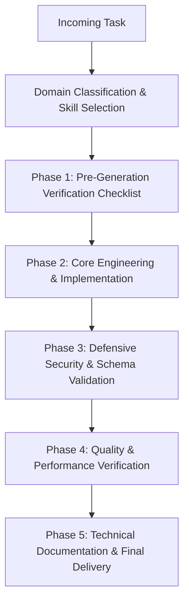

# Antigravity Agent Orchestrator Specification

## Master Contract & Architecture Overview

This orchestrator specification governs all AI agent interactions, autonomous tasks, code generations, code reviews, and architectural modifications within this repository. All agent personas operating inside this environment must adhere strictly to the protocols, verification standards, and quality boundaries established herein.

Every task executed by an agent must be classified, routed through the appropriate domain skills, evaluated against pre-generation checklists, and verified against strict performance, security, design, and documentation budgets before submission.

---

## Skill Directory Index & Routing Matrix

The agent skills reside under `.agents/skills/` and are grouped into specialized operational domains. When processing user prompts, tasks, or reviews, agents MUST activate the relevant skills according to the matrix below:

| Domain | Skill Identifier | Path | Trigger & Scope |
|---|---|---|---|
| **Frontend** | `taste-design` | [`.agents/skills/frontend/taste-design/SKILL.md`](file:///c:/Users/Admin/OneDrive/Desktop/Source%20Code/MERN%20SaaS%20Boiler-Plate/.agents/skills/frontend/taste-design/SKILL.md) | Visual styling, layout architecture, typography selection, palette composition, and anti-slop aesthetic enforcement. |
| **Frontend** | `gsap-motion` | [`.agents/skills/frontend/gsap-motion/SKILL.md`](file:///c:/Users/Admin/OneDrive/Desktop/Source%20Code/MERN%20SaaS%20Boiler-Plate/.agents/skills/frontend/gsap-motion/SKILL.md) | Lenis smooth scrolling, GSAP timelines, ticker synchronization, ScrollTrigger scrubbing, and React context lifecycles. |
| **Frontend** | `threejs-webgl` | [`.agents/skills/frontend/threejs-webgl/SKILL.md`](file:///c:/Users/Admin/OneDrive/Desktop/Source%20Code/MERN%20SaaS%20Boiler-Plate/.agents/skills/frontend/threejs-webgl/SKILL.md) | Three.js / R3F canvases, shader materials, particle systems, instanced rendering, viewport parallax, and resource disposal. |
| **Frontend** | `cursor-effects` | [`.agents/skills/frontend/cursor-effects/SKILL.md`](file:///c:/Users/Admin/OneDrive/Desktop/Source%20Code/MERN%20SaaS%20Boiler-Plate/.agents/skills/frontend/cursor-effects/SKILL.md) | Fluid custom pointers, `quickTo` tweening, magnetic interactive attraction, and cursor-reactive particle physics. |
| **Frontend** | `ui-ux-design-system` | [`.agents/skills/frontend/ui-ux-design-system/SKILL.md`](file:///c:/Users/Admin/OneDrive/Desktop/Source%20Code/MERN%20SaaS%20Boiler-Plate/.agents/skills/frontend/ui-ux-design-system/SKILL.md) | Design tokens, WCAG AA compliance (≥4.5:1), keyboard traps/focus ring management, and component micro-interactions. |
| **Security** | `vulnerability-audit` | [`.agents/skills/security/vulnerability-audit/SKILL.md`](file:///c:/Users/Admin/OneDrive/Desktop/Source%20Code/MERN%20SaaS%20Boiler-Plate/.agents/skills/security/vulnerability-audit/SKILL.md) | Zero-secret policy, strict input sanitization, Content Security Policy (CSP), CORS whitelists, and OWASP Top 10 mitigation. |
| **Security** | `auth-session` | [`.agents/skills/security/auth-session/SKILL.md`](file:///c:/Users/Admin/OneDrive/Desktop/Source%20Code/MERN%20SaaS%20Boiler-Plate/.agents/skills/security/auth-session/SKILL.md) | HttpOnly/Secure/SameSite=Strict cookie sessions, vetted token standards, RBAC authorization gates, and brute-force throttling. |
| **Backend** | `api-contracts` | [`.agents/skills/backend/api-contracts/SKILL.md`](file:///c:/Users/Admin/OneDrive/Desktop/Source%20Code/MERN%20SaaS%20Boiler-Plate/.agents/skills/backend/api-contracts/SKILL.md) | Zod schema validation for payloads/queries/webhooks, RFC 7807 problem details, and semantic HTTP status codes. |
| **Backend** | `database-resilience` | [`.agents/skills/backend/database-resilience/SKILL.md`](file:///c:/Users/Admin/OneDrive/Desktop/Source%20Code/MERN%20SaaS%20Boiler-Plate/.agents/skills/backend/database-resilience/SKILL.md) | Parameterized queries/ORMs, N+1 detection, zero-downtime migration plans, index coverage, and connection pool safeguards. |
| **Quality** | `tdd-testing` | [`.agents/skills/quality/tdd-testing/SKILL.md`](file:///c:/Users/Admin/OneDrive/Desktop/Source%20Code/MERN%20SaaS%20Boiler-Plate/.agents/skills/quality/tdd-testing/SKILL.md) | Vitest unit/integration testing, Playwright end-to-end browser tests, edge case assertions, and test-first discipline. |
| **Quality** | `performance-vitals` | [`.agents/skills/quality/performance-vitals/SKILL.md`](file:///c:/Users/Admin/OneDrive/Desktop/Source%20Code/MERN%20SaaS%20Boiler-Plate/.agents/skills/quality/performance-vitals/SKILL.md) | Core Web Vitals (LCP < 2.5s, INP < 200ms, CLS < 0.1), dynamic code splitting, image formats, and bundle budget governance. |
| **Docs** | `technical-documentation` | [`.agents/skills/docs/technical-documentation/SKILL.md`](file:///c:/Users/Admin/OneDrive/Desktop/Source%20Code/MERN%20SaaS%20Boiler-Plate/.agents/skills/docs/technical-documentation/SKILL.md) | Diátaxis framework documentation, Architecture Decision Records (ADRs), Mermaid diagrams, and concise technical voice. |
| **Docs** | `api-reference` | [`.agents/skills/docs/api-reference/SKILL.md`](file:///c:/Users/Admin/OneDrive/Desktop/Source%20Code/MERN%20SaaS%20Boiler-Plate/.agents/skills/docs/api-reference/SKILL.md) | Explicit JSON endpoint specs, authorization headers, error dictionaries, status matrices, and curl verification snippets. |

---

## Multi-Skill Routing & Execution Protocol

When a user request arrives, the agent must execute the following sequential state machine:

1. **Classification**: Identify user requirements and map them to primary and secondary skills (e.g., an animated dashboard feature routes through `taste-design`, `gsap-motion`, `api-contracts`, and `tdd-testing`).
2. **Pre-Generation Audit**: Verify prerequisites, environment constraints, existing patterns, and dependency versions before writing code.
3. **Execution**: Apply domain-specific standards without skipping structural details or relying on unverified assumptions.
4. **Post-Generation Review**: Run static checks, ensure tests cover edge conditions, audit performance metrics, and format documentation in active voice.

---

## Pre-Generation Checklist

Before delivering code or architecture plans, agents must assert each of the following criteria:

- [ ] **Context Verification**: Existing codebase conventions, dependencies, and file structures have been inspected.
- [ ] **No Placeholders or Stubs**: Zero occurrences of `// TODO`, `/* Implement later */`, or placeholder data in production-facing paths.
- [ ] **Aesthetic Integrity**: No generic neon-purple AI gradients, centered 3-card templates, unstyled form elements, or browser-default typography.
- [ ] **Memory & Lifecycle Safety**: All event listeners, GSAP timelines, WebGL contexts, and intervals possess explicit cleanup logic on component teardown.
- [ ] **Defensive Boundaries**: Every external API, client input, and database mutation is validated with strict runtime schemas (Zod).
- [ ] **Zero Hardcoded Secrets**: Every credential, secret token, or private key is loaded via verified environment variables with companion definitions in `.env.example`.
- [ ] **Error Contract Transparency**: All API failures return structured RFC 7807 Problem Details with predictable error keys and status codes.
- [ ] **Test Coverage**: All critical paths and boundary conditions have unit or integration tests created using Vitest before marking tasks complete.

---

## Zero-AI-Slop Design Mandate

AI-generated interfaces often default to predictable, low-effort visual cliches. This project strictly bans the following anti-patterns:

1. **Banned Gradients**: No bright purple-to-indigo or cyan-to-magenta linear backgrounds (`linear-gradient(to right, #6366f1, #a855f7)`). Use subtle tonal shifts over deep slate/charcoal foundations (`#090D16`, `#0F172A`, `#1E293B`) or organic warm neutrals.
2. **Banned Layouts**: No symmetric, centered 3-column pricing or feature grids without hierarchical variety. Employ asymmetrical bento grids, dynamic proportioning (e.g., 8-col / 4-col split), and intentional whitespace balancing.
3. **Typography**: Browser-default stacks (`sans-serif`, unconfigured Arial) are forbidden. Use deliberate typography pairings: an editorial or display font for headings (`Outfit`, `Cabinet Grotesk`, `Playfair`) paired with a refined geometric or neutral sans for body text (`Inter`, `Plus Jakarta Sans`, `Geist`) and a monospaced font for data and code (`JetBrains Mono`, `Geist Mono`).
4. **Visual Depth**: No flat cards with generic `box-shadow: 0 4px 6px rgba(0,0,0,0.1)`. Build layered depth with multi-stop dark shadows, hairline borders (`1px solid rgba(255, 255, 255, 0.08)`), subtle noise textures, and backdrop blurs.

---

## Defensive Security Requirements

All code produced must conform to defensive security standards:

- **Authentication**: JWTs must NOT be stored in `localStorage` or `sessionStorage`. All authentication tokens and session IDs must reside in `HttpOnly`, `Secure`, `SameSite=Strict` cookies.
- **Access Control**: Role-Based Access Control (RBAC) middleware must run before database operations on every protected endpoint.
- **Sanitization & CSP**: Strict Content Security Policies (CSP) with nonce-based script execution where feasible; zero usage of `dangerouslySetInnerHTML` without DOMPurify sanitization.
- **SQL & NoSQL Injection**: Parameterized queries or type-safe ORMs only. Raw string interpolation in database queries is strictly forbidden.
- **Rate Limiting**: Public authentication and mutation endpoints must enforce rate limits via Redis or in-memory sliding windows to mitigate brute-force attacks.

---

## Performance Budgets

All frontend and backend features must adhere to quantifiable performance thresholds:

- **Largest Contentful Paint (LCP)**: ≤ 2.2 seconds on 4G mobile emulation.
- **Interaction to Next Paint (INP)**: ≤ 180 milliseconds.
- **Cumulative Layout Shift (CLS)**: ≤ 0.05.
- **First Input Delay (FID) / Total Blocking Time (TBT)**: TBT ≤ 150 milliseconds.
- **Initial JavaScript Bundle Size**: ≤ 180 kB compressed (gzip/brotli) for the initial route bundle.
- **Animation Refresh Rate**: Smooth 60fps / 120fps with zero layout thrashing or long-task spikes during scroll-scrubbed motion.

---

## Documentation Standards

Documentation must follow the Diátaxis framework:
1. **Tutorials**: Learning-oriented, step-by-step guidance for beginners.
2. **How-To Guides**: Problem-oriented, actionable steps to solve specific operational challenges.
3. **Reference**: Information-oriented, comprehensive technical descriptions (APIs, parameters, schemas, configuration).
4. **Explanation**: Understanding-oriented, architectural reasoning, trade-offs, and context.

All documentation must be written in an active, direct voice without conversational pleasantries or filler words.
