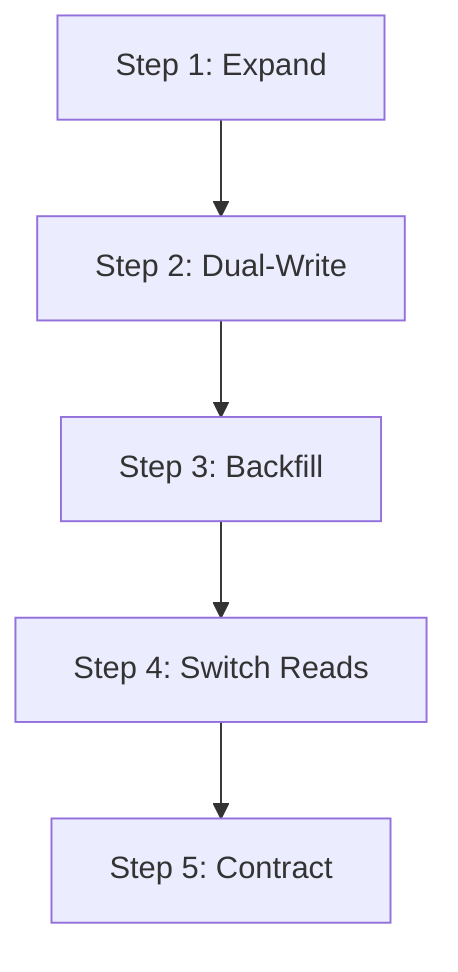

# Database Resilience, ORM Safety & Migration Architecture

## Core Directives

Database failures degrade entire distributed systems. Inefficient queries, missing indexes, unparameterized strings, and blocking table locks cause cascading latency spikes and outages.

This skill governs:
1. **Parameterized Queries & ORM Enforcement**: Absolute ban on string concatenation in SQL or NoSQL queries.
2. **N+1 Query Detection & Prevention**: Eager loading with batching/join strategies over iterative subqueries in loops.
3. **Zero-Downtime Non-Destructive Migrations**: Safe schema evolution patterns (Expand and Contract).
4. **Index Coverage & Connection Pool Safeguards**: Mandatory indexes on all foreign keys, filter predicates, and sort columns.

---

## 1. Absolute Query Parameterization

Never construct SQL or NoSQL statements using template literals or string concatenation.

### Anti-Pattern vs. Production Standard
```typescript
// BANNED: Vulnerable to SQL Injection
const dangerousUser = await db.query(`SELECT * FROM users WHERE email = '${userEmail}'`);

// APPROVED: Parameterized query via ORM / Query Builder
const safeUser = await db.query(
  'SELECT id, email, created_at FROM users WHERE email = $1 LIMIT 1',
  [userEmail]
);
```

### Mongoose / MongoDB Query Sanitization
When using MongoDB/Mongoose, guard against NoSQL Operator Injection (e.g. `{ "$gt": "" }`):
```typescript
import sanitize from 'mongo-sanitize';

export function findUserByEmail(rawEmail: unknown) {
  // Strips any keys starting with '$'
  const cleanEmail = sanitize(rawEmail);
  if (typeof cleanEmail !== 'string') {
    throw new Error('Invalid email parameter format');
  }
  return UserModel.findOne({ email: cleanEmail }).exec();
}
```

---

## 2. Preventing N+1 Query Degradation

Executing a database query inside an iteration loop over `N` items creates `N + 1` roundtrips, causing severe connection pool exhaustion and latency spikes.

### Anti-Pattern: Loop Querying (N+1)
```typescript
// BANNED: 1 query for teams + N queries for members
const teams = await db.select().from(teamsTable);
for (const team of teams) {
  team.members = await db.select().from(membersTable).where(eq(membersTable.teamId, team.id));
}
```

### Production Standard: Batched In-Query or Relational Join
```typescript
// APPROVED: Single batched query using DataLoader or SQL IN-operator
const teams = await db.select().from(teamsTable);
const teamIds = teams.map((t) => t.id);

const allMembers = await db
  .select()
  .from(membersTable)
  .where(inArray(membersTable.teamId, teamIds));

// Group in-memory with O(N) map
const membersByTeamId = allMembers.reduce((acc, member) => {
  if (!acc[member.teamId]) acc[member.teamId] = [];
  acc[member.teamId].push(member);
  return acc;
}, {} as Record<string, typeof allMembers>);

const teamsWithMembers = teams.map((team) => ({
  ...team,
  members: membersByTeamId[team.id] || [],
}));
```

---

## 3. Non-Destructive Zero-Downtime Migrations

Production databases must never drop, rename, or alter columns synchronously while existing application instances are actively serving traffic.

### The Expand & Contract Pattern
When modifying existing columns (e.g., changing `name` to `first_name` and `last_name`):



1. **Phase 1: Expand (Migration)**:
   Add new nullable columns (`first_name`, `last_name`) without touching the existing `name` column.
2. **Phase 2: Dual-Write (Application Code)**:
   Deploy code that writes to both `name` AND (`first_name`, `last_name`), but continues reading from `name`.
3. **Phase 3: Backfill (Background Worker)**:
   Run an idempotent background job chunked by primary key to split and copy legacy `name` records into `first_name` and `last_name`.
4. **Phase 4: Switch Reads (Application Code)**:
   Update application code to read from `first_name` and `last_name`.
5. **Phase 5: Contract (Migration)**:
   After confirming stability and verifying zero remaining queries on `name`, drop the obsolete `name` column in a separate migration window.

---

## 4. Mandatory Index Coverage Rules

1. **Foreign Keys**: Every foreign key column referencing another table MUST have an explicit B-tree index. Missing foreign key indexes cause full table scans during joins and cascade deletions.
2. **Compound Filter Indexes**: If an endpoint filters on multiple columns (e.g. `WHERE tenant_id = ? AND status = ? ORDER BY created_at DESC`), create a compound index covering the columns in order: `(tenant_id, status, created_at DESC)`.
3. **Unique Constraints**: All business logic uniqueness rules (e.g., unique email per organization) must be enforced via unique database indexes, not just application-level lookups.

---

## 5. Connection Pooling & Timeout Discipline

Always configure conservative connection pool limits and request timeouts to prevent hung socket accumulation:

```typescript
// src/config/database.ts
import { Pool } from 'pg';

export const dbPool = new Pool({
  connectionString: process.env.DATABASE_URL,
  max: 20, // Maximum pool connections per instance
  idleTimeoutMillis: 30000, // Close idle connections after 30s
  connectionTimeoutMillis: 3000, // Fail fast if connection cannot be acquired in 3s
  statement_timeout: 5000, // Kill any query taking longer than 5 seconds
});
```
