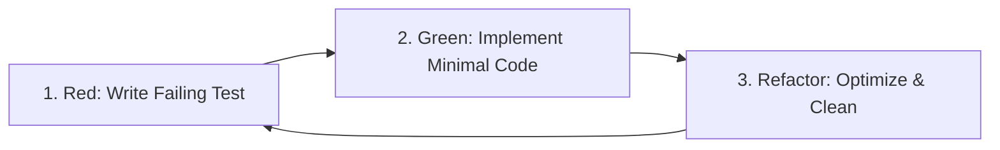

# Test-Driven Development (TDD) & Quality Engineering Protocol

## Core Directives

Shipping untested code or writing superficial "happy path only" tests is prohibited. Testing is an active design tool that validates architectural boundaries, documents intent, and guarantees system resilience against edge cases.

This skill governs:
1. **The Red-Green-Refactor Cycle**: Mandatory test-first construction for all business logic, utilities, and API contracts.
2. **Vitest Unit & Integration Standards**: Mocking policies, snapshot guidelines, and edge-condition coverage.
3. **Playwright E2E Verification**: Reliable, locator-driven end-to-end browser journeys covering critical user paths.
4. **Boundary & Malicious Input Testing**: Systematic verification of nulls, empty states, boundary values, and malformed inputs.

---

## 1. The Red-Green-Refactor Lifecycle

Agents must execute the test-driven process sequentially:



1. **Step 1: Red**: Author the test file defining the desired behavior before implementing the underlying module. Run the test suite and confirm it fails for the expected reason (e.g. method missing or assertion unmet).
2. **Step 2: Green**: Write the minimal code necessary to make the test pass. Do not write anticipatory features not covered by tests.
3. **Step 3: Refactor**: Clean up duplication, improve algorithmic performance, and enforce typing without changing external behavior. Ensure all tests remain green.

---

## 2. Vitest Unit & Integration Testing Standards

### File Organization
- Co-locate test files directly alongside their implementation modules with `.spec.ts` or `.test.ts` extensions (e.g. `auth.service.ts` and `auth.service.spec.ts`).
- Shared integration tests and API endpoint tests reside in `tests/integration/` or `tests/api/`.

### Writing Exhaustive Unit Tests
Every unit test must assert:
- The standard happy path.
- Boundary conditions (0, -1, `Number.MAX_SAFE_INTEGER`, empty array, single item, 10,000 items).
- Malformed inputs (`undefined`, `null`, invalid types, non-UTF8 strings).
- Expected failure cases and custom error instances.

```typescript
// src/services/billing-calculator.spec.ts
import { describe, it, expect } from 'vitest';
import { calculateProratedSubscription, SubscriptionPlan } from './billing-calculator';

describe('calculateProratedSubscription', () => {
  const mockPlan: SubscriptionPlan = {
    id: 'plan_pro',
    monthlyPriceCents: 3000,
    seatLimit: 10,
  };

  it('calculates exact mid-cycle upgrade proration correctly', () => {
    const result = calculateProratedSubscription({
      currentPlan: mockPlan,
      daysRemainingInCycle: 15,
      totalDaysInCycle: 30,
      additionalSeats: 2,
    });

    // 15/30 = 0.5 cycle * (additional seat cost)
    expect(result.proratedCents).toBe(300);
    expect(result.nextBillingDate).toBeDefined();
  });

  it('throws an AppError when days remaining exceeds total cycle days', () => {
    expect(() =>
      calculateProratedSubscription({
        currentPlan: mockPlan,
        daysRemainingInCycle: 35,
        totalDaysInCycle: 30,
        additionalSeats: 1,
      })
    ).toThrowError(/exceeds total cycle duration/i);
  });

  it('returns zero charge when additional seats is zero', () => {
    const result = calculateProratedSubscription({
      currentPlan: mockPlan,
      daysRemainingInCycle: 15,
      totalDaysInCycle: 30,
      additionalSeats: 0,
    });

    expect(result.proratedCents).toBe(0);
  });

  it('rejects negative seat adjustments', () => {
    expect(() =>
      calculateProratedSubscription({
        currentPlan: mockPlan,
        daysRemainingInCycle: 15,
        totalDaysInCycle: 30,
        additionalSeats: -2,
      })
    ).toThrowError(/cannot be negative/i);
  });
});
```

---

## 3. Playwright End-to-End (E2E) Browser Testing

Playwright tests must validate full user flows without relying on brittle CSS selectors or arbitrary `page.waitForTimeout()` sleeps.

### Rules for Playwright Tests
1. **User-Facing Locators Only**: Always locate elements using `page.getByRole()`, `page.getByLabel()`, or `page.getByText()`. Never use fragile classes like `.btn-primary` or auto-generated hashes.
2. **Auto-Waiting**: Rely on Playwright's built-in web-first assertions (`expect(locator).toBeVisible()`).
3. **Isolated Test State**: Each test must execute with its own clean storage state or fixture authentication.

```typescript
// tests/e2e/auth-flow.spec.ts
import { test, expect } from '@playwright/test';

test.describe('Authentication Journey', () => {
  test.beforeEach(async ({ page }) => {
    await page.goto('/login');
  });

  test('displays validation errors on empty submission', async ({ page }) => {
    const submitBtn = page.getByRole('button', { name: /sign in/i });
    await submitBtn.click();

    await expect(page.getByText(/email address is required/i)).toBeVisible();
    await expect(page.getByText(/password is required/i)).toBeVisible();
  });

  test('successfully logs in with valid credentials and redirects to dashboard', async ({ page }) => {
    await page.getByLabel(/email/i).fill('staff@company.com');
    await page.getByLabel(/password/i).fill('CorrectHorseBatteryStaple123!');
    await page.getByRole('button', { name: /sign in/i }).click();

    // Verify successful redirection and session state
    await expect(page).toHaveURL(/\/dashboard/);
    await expect(page.getByRole('heading', { name: /overview/i })).toBeVisible();
  });
});
```

---

## 4. Test Verification Checklist Before Task Delivery

- [ ] All new logic paths have corresponding tests in `.spec.ts` files.
- [ ] Boundary limits (0, null, extremes, empty arrays) explicitly tested.
- [ ] Network failure and rejected promise handling verified via mocked failures.
- [ ] No arbitrary sleeps (`setTimeout` or `page.waitForTimeout(5000)`) in any test.
- [ ] Test suite executes cleanly without uncaught warnings, unhandled rejections, or leaked processes.
