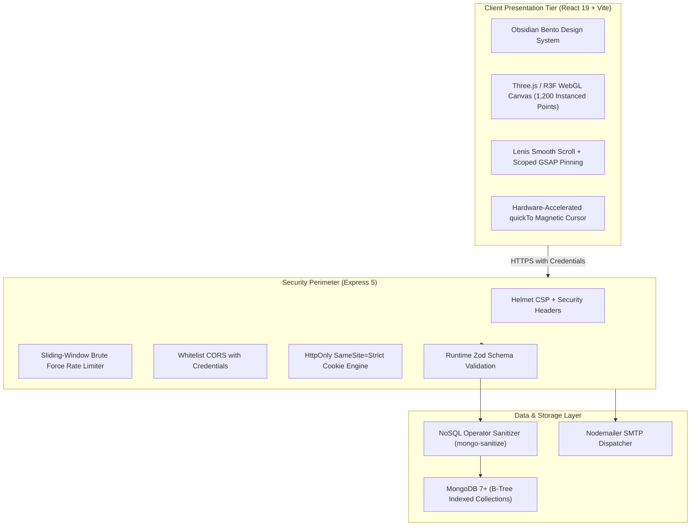

# SaaS Pro — High-Performance Cloud Orchestration Platform

[](https://github.com/BradleyXiX/MERN-SaaS-Boilerplate)
[](docs/explanation/architecture.md)
[](#platform-architecture--core-capabilities)
[](docs/explanation/security-model.md)
[](TESTING.md)

A production-grade, enterprise cloud orchestration boilerplate engineered with defense-in-depth security, runtime Zod contracts, React 19 Three Fiber WebGL graphics, and Lenis-GSAP synchronized inertia storytelling.

---

## Diátaxis Documentation Portal

Documentation is structured according to the **Diátaxis Framework**, cleanly separating learning, task recipes, factual references, and system explanations:

| Quadrant | Focus | Primary Guides |
|---|---|---|
| **Tutorials** | *Learning-oriented* | • [End-to-End Platform Quickstart](docs/tutorials/quickstart-guide.md)<br>• [Local Setup & First Login](docs/tutorials/quickstart-guide.md#step-5-complete-authentication-flow) |
| **How-To Guides** | *Task-oriented* | • [Production Deployment & Containerization](docs/how-to/production-deployment.md)<br>• [Configuring Cryptographic Cookie Authentication](docs/how-to/secure-cookie-auth.md)<br>• [Automated Testing & Assertion Strategy](docs/how-to/testing-strategy.md) |
| **Reference** | *Information-oriented* | • [REST API Reference Specification (RFC 7807)](API.md)<br>• [Environment Variables & Token Configuration](docs/reference/configuration.md)<br>• [Complete Endpoint Schema Contracts](docs/reference/api-reference.md) |
| **Explanation** | *Understanding-oriented* | • [System Architecture & Defensive Pipeline](ARCHITECTURE.md)<br>• [Cryptographic Security & Token Rotation Model](REFRESH_TOKEN_GUIDE.md)<br>• [Motion Engine & WebGL Graphics Architecture](docs/explanation/motion-webgl-engine.md) |
| **ADR Archive** | *Architectural Decisions* | • [ADR-001: HttpOnly Cookies and Zod Contracts](docs/adr/001-cookie-session-and-zod-contracts.md)<br>• [ADR-002: Unified Lenis-GSAP RAF Ticker](docs/adr/002-lenis-gsap-unified-raf.md)<br>• [ADR-003: Single Draw Call InstancedMesh Constellation](docs/adr/003-instanced-webgl-particle-constellation.md) |

---

## System Architecture



---

## Platform Architecture & Core Capabilities

### 1. Zero-AI-Slop Visual System
- **Palette**: Deep Obsidian foundation (`#090B10`, `#0F131C`, `#161B26`), hairline borders (`1px solid rgba(255, 255, 255, 0.07)`), and intentional spectral accents (electric cyan `#06B6D4` and amber `#F59E0B`).
- **Typography**: Paired editorial display typeface (`Outfit`) with geometric sans (`Plus Jakarta Sans`) and telemetry monospace (`JetBrains Mono`).
- **Layout Architecture**: 12-column asymmetric Bento grids replacing generic 3-card templates.

### 2. Cinematic Motion & WebGL Graphics
- **Unified Scroll RAF**: Lenis smooth scroll ticker directly bound to `gsap.ticker` to prevent layout thrashing and ScrollTrigger pin tearing.
- **Narrative Storytelling**: Multi-card sequential scroll scrubbing (`scrub: 1`, `pin: true`) with scoped React lifecycle teardown via `useGSAP()`.
- **Three.js / React Three Fiber**: 1,200-node particle constellation with single-draw-call `InstancedMesh`, ACES Filmic tonemapping, clamped DPR (1–1.8), and lerped NDC mouse coordinate parallax.
- **Magnetic Pointer Physics**: Sub-millisecond cursor tracking using `gsap.quickTo()` with proximity-based button snapping and automatic touch-screen deactivation.

### 3. Defensive Security Perimeter
- **Zero LocalStorage JWTs**: Session and refresh tokens are stored strictly inside `HttpOnly`, `Secure`, `SameSite=Strict` cookies.
- **Zod Runtime Schema Contracts**: Ingress validation across all endpoints returning RFC 7807 Problem Details (`application/problem+json`).
- **Injection Mitigation**: Automated NoSQL operator neutralization using `mongo-sanitize`.
- **Brute-Force Throttling**: Sliding-window rate limiters across public authentication paths (5 failed attempts / 15 min).

---

## Quickstart

### 1. Configure Environment Variables
Create a `.env` file in `server/` modeled after [`server/.env.example`](file:///c:/Users/Admin/OneDrive/Desktop/Source%20Code/MERN%20SaaS%20Boiler-Plate/server/.env.example):

```env
PORT=5000
NODE_ENV=development
MONGO_URI=mongodb://localhost:27017/saas
JWT_SECRET=super_secret_cryptographic_jwt_key_at_least_32_characters_long
REFRESH_TOKEN_SECRET=super_secret_refresh_key_at_least_32_characters_long
CORS_ALLOWED_ORIGINS=http://localhost:5173,http://127.0.0.1:5173
```

### 2. Install Dependencies
```bash
npm run install:all
```

### 3. Boot Development Stack
```bash
npm run dev
```
The client console boots at `http://localhost:5173` with the backend API listening at `http://localhost:5000`.

---

## API Contract Overview

All endpoints strictly adhere to **RFC 7807 Problem Details for HTTP APIs**. Complete request/response schemas, constraint matrices, and copy-pasteable `curl` commands are available in the [API Reference Specification](API.md).

| Method | Endpoint | Authentication | Rate Limit | Description |
|---|---|---|---|---|
| `POST` | `/api/auth/register` | Public | 5 req / 15m | Register user identity with Zod schema validation |
| `POST` | `/api/auth/login` | Public | 5 req / 15m | Issue dual `HttpOnly` cookies (`saas_auth_session`, `saas_refresh_session`) |
| `POST` | `/api/auth/refresh-token` | Cookie / Body | Standard | Rotate expired access tokens via hashed refresh token in MongoDB |
| `GET` | `/api/auth/verify-email` | Public | Standard | Validate cryptographic email verification token |
| `POST` | `/api/auth/forgot-password` | Public | 3 req / 1h | Dispatch 1-hour password reset token (Anti-enumeration safe) |
| `POST` | `/api/auth/reset-password` | Public | 3 req / 1h | Reset password and invalidate all active session tokens |
| `GET` | `/api/auth/me` | Cookie / Bearer | Standard | Retrieve sanitized user document (`protect` middleware) |
| `POST` | `/api/auth/logout` | Cookie / Body | Standard | Purge session cookies and revoke refresh token in database |
| `GET` | `/api/health` | Public | None | Return API gateway and MongoDB connection status |

---

## Test Verification Suite

Assert codebase integrity using the automated test suites:

```bash
# Execute Client Vitest Suite (15 passing tests)
npm test --prefix client -- --run

# Execute Server Jest Suite (8 passing tests)
npm test --prefix server -- --runInBand
```

For detailed assertion patterns and CI configuration, see [TESTING.md](TESTING.md).

---

## Project Structure & Contributing

- [System Architecture](ARCHITECTURE.md)
- [Development Guide](DEVELOPMENT.md)
- [Deployment Recipes](DEPLOYMENT.md)
- [Cryptographic Refresh Token Guide](REFRESH_TOKEN_GUIDE.md)
- [Contributing Guidelines](CONTRIBUTING.md)

---

## License

MIT © 2026. Built in strict adherence to `.agents/AGENTS.md` Platform Engineering Standards.
