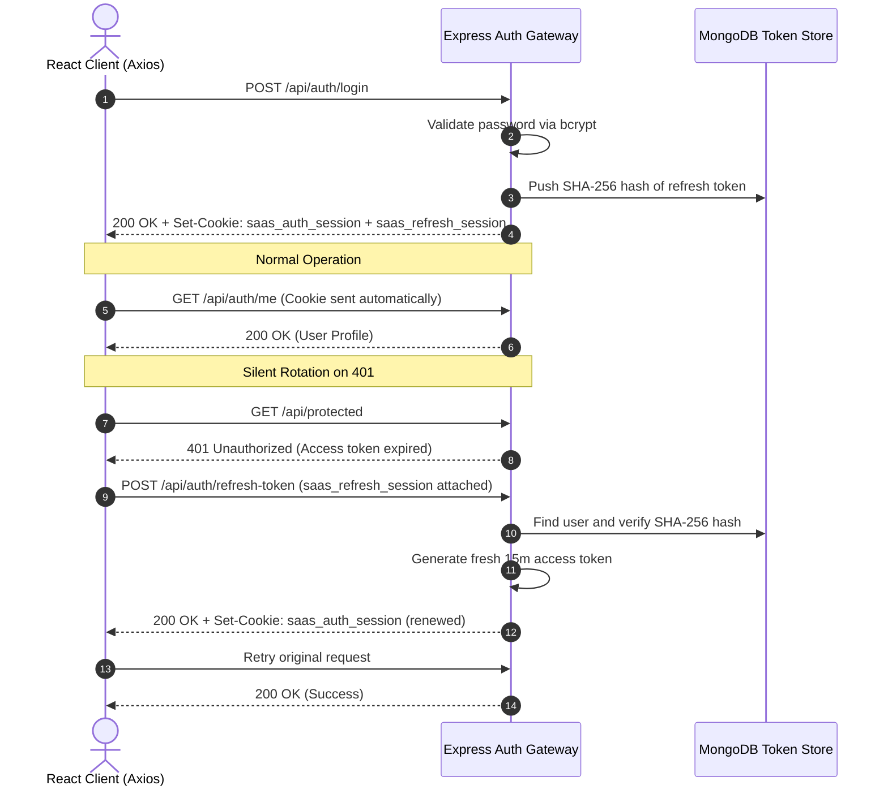

# SaaS Pro — Cryptographic Refresh Token & Cookie Session Guide

Authoritative technical documentation on the dual-token cryptographic cookie rotation architecture used across SaaS Pro client and server systems.

---

## 1. Security Architecture & Threat Mitigation

### Elimination of LocalStorage Storage Risks

Storing authentication tokens in browser `localStorage` leaves applications susceptible to complete session compromise via Cross-Site Scripting (XSS). In this platform:
- All authentication state is managed through `HttpOnly`, `Secure`, `SameSite=Strict` cookies.
- JavaScript running in the browser cannot read or exfiltrate either token (`document.cookie` returns empty).
- `SameSite=Strict` guarantees cookies are never included in third-party cross-site requests, mitigating Cross-Site Request Forgery (CSRF).

---

## 2. Token Lifecycle & Specifications

| Token | Cookie Identifier | Expiration | Purpose | Storage Mechanism |
|---|---|---|---|---|
| **Access Token** | `saas_auth_session` | 15 Minutes | Grants access to protected endpoints | `HttpOnly` Cookie (`/`) |
| **Refresh Token** | `saas_refresh_session` | 7 Days | Silent rotation for access tokens | `HttpOnly` Cookie & SHA-256 in MongoDB |

---

## 3. Server Implementation Architecture

### Database Schema (`server/models/User.js`)

Refresh tokens are stored as hashed records within the `refreshTokens` array:

```javascript
refreshTokens: [
  {
    token: String,           // Cryptographic SHA-256 hash of refresh token
    expiresAt: Date,        // Expiration timestamp
    createdAt: Date         // Issuance timestamp
  }
]
```

### Token Service (`server/utils/tokenService.js`)

Core cryptographic functions:
- `generateTokenPair(userId)`: Generates both 15m access token and 7d refresh token.
- `verifyAccessToken(token)`: Validates signature and decodes claims.
- `verifyRefreshToken(token)`: Validates long-lived refresh signature.
- `hashToken(token)`: Computes `sha256` digest of raw JWT before database queries.

### Session Cookie Engine (`server/utils/cookieHelper.js`)

Sets and clears secure cookies on the HTTP response stream:

```javascript
const setAuthCookies = (res, { accessToken, refreshToken }) => {
  if (accessToken) {
    res.cookie('saas_auth_session', accessToken, {
      httpOnly: true,
      secure: process.env.NODE_ENV === 'production',
      sameSite: 'strict',
      path: '/',
      maxAge: 15 * 60 * 1000, // 15 minutes
    });
  }
  if (refreshToken) {
    res.cookie('saas_refresh_session', refreshToken, {
      httpOnly: true,
      secure: process.env.NODE_ENV === 'production',
      sameSite: 'strict',
      path: '/',
      maxAge: 7 * 24 * 60 * 60 * 1000, // 7 days
    });
  }
};
```

---

## 4. End-to-End Rotation Sequence



---

## 5. Client Interceptor Queue (`client/src/utils/api.js`)

The Axios client instance automatically queues requests during token rotation to prevent parallel token refresh race conditions:

```javascript
let isRefreshing = false;
let failedQueue = [];

api.interceptors.response.use(
  (response) => response,
  async (error) => {
    const originalRequest = error.config;
    if (error.response?.status === 401 && !originalRequest._retry && !originalRequest.url?.includes('/api/auth/login')) {
      if (isRefreshing) {
        return new Promise((resolve, reject) => {
          failedQueue.push({ resolve, reject });
        }).then(() => api(originalRequest));
      }
      originalRequest._retry = true;
      isRefreshing = true;

      try {
        await api.post('/api/auth/refresh-token', {});
        processQueue(null);
        return api(originalRequest);
      } catch (refreshErr) {
        processQueue(refreshErr);
        window.dispatchEvent(new Event('auth:session-expired'));
        return Promise.reject(refreshErr);
      } finally {
        isRefreshing = false;
      }
    }
    return Promise.reject(error);
  }
);
```

---

## 6. Multi-Device Logout & Session Revocation

To revoke tokens:
- **Single-Device Logout (`POST /api/auth/logout`)**: Removes the current device's refresh token hash from MongoDB and clears cookies.
- **Global Logout (`POST /api/auth/logout` with `{"logoutAll": true}`)**: Sets `user.refreshTokens = []`, revoking all active sessions across all devices.
