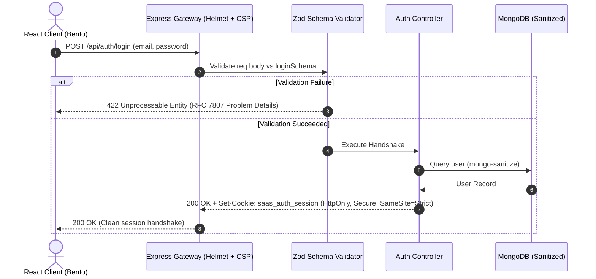

# ADR-001: Migration to Cryptographic HttpOnly Cookie Sessions and Zod Contracts

- **Status**: Accepted
- **Deciders**: Principal Platform Architect, Security Engineering Lead
- **Date**: 2026-10-12
- **Technical Story**: Eliminate client-side XSS token exfiltration risks and replace unstructured endpoint errors with RFC 7807 problem details and strict runtime schema verification.

---

## Context & Problem Statement

Prior to this architectural migration, authentication tokens (`accessToken`, `refreshToken`) were stored directly within browser `localStorage`. Any malicious JavaScript payload injected via cross-site scripting (XSS) or third-party dependency compromise could read the authentication credentials immediately (`localStorage.getItem('token')`).

Additionally, backend validation relied on disparate manual checks, and API error formats were inconsistent (varying between `{ error: '...' }`, `{ message: '...' }`, and `{ success: false }`).

---

## Decision Drivers

1. **Defense-in-Depth Authentication**: Zero access to session tokens from `document.cookie` or client scripts.
2. **Standardized Error Semantics**: Uniform error payloads adhering to RFC 7807 (`application/problem+json`).
3. **Fail-Fast Request Boundaries**: Validate request shapes via Zod before hitting business controllers.
4. **Zero-AI-Slop Aesthetics**: Replace generic indigo templates with an Obsidian & Slate tokenized Bento design system.

---

## Considered Options

1. **Option 1**: LocalStorage Bearer Token pattern (Status Quo)
2. **Option 2**: HttpOnly Cookie Sessions with SameSite=Strict and Zod Contracts (Chosen)
3. **Option 3**: OAuth2 External Identity Provider (Auth0/Okta)

---

## Evaluation & Trade-Off Matrix

| Criterion | Option 1: LocalStorage | Option 2: HttpOnly + Zod (Chosen) | Option 3: External IdP |
|---|---|---|---|
| **XSS Immunity** | ❌ Vulnerable | ✅ Immune (`httpOnly: true`) | ✅ Immune (if cookie-based) |
| **CSRF Defense** | N/A (Bearer header) | ✅ Strict (`sameSite: 'strict'`) | High |
| **Schema Integrity** | ❌ Ad-hoc runtime | ✅ 100% typed via Zod | Moderate |
| **Operational Cost** | $0 | $0 (Zero external lock-in) | $150+/mo per MAU tier |
| **Developer Autonomy** | High | High | Low (Vendor SDK bound) |

---

## Architecture Sequence Diagram

---

## Consequences

- **Positive**:
  - Tokens are strictly isolated from client script execution.
  - All errors return predictable RFC 7807 shapes with field-level breakdowns.
  - NoSQL operator injection is neutralized via `mongo-sanitize`.
- **Negative**:
  - Direct browser API testing requires cookie handling or utilizing the Bearer fallback in curl.
