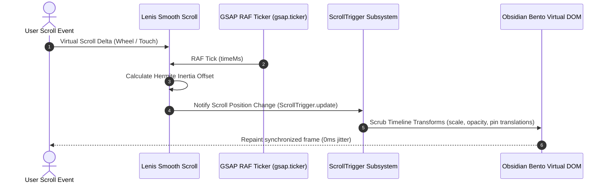

# ADR-002: Unified RAF Synchronization for Lenis Smooth Scroll and GSAP ScrollTrigger

- **Status**: Accepted
- **Deciders**: Principal Frontend Architect, Performance Engineering Lead
- **Date**: 2026-10-12
- **Technical Story**: Eliminate visual micro-stutter, ScrollTrigger pin tearing, and duplicate RAF loops during scroll-driven interface animations.

---

## Context & Problem Statement

Modern marketing surfaces require inertia-based smooth scrolling combined with scroll-scrubbed element pinning and timeline animations. Historically, running independent RequestAnimationFrame (RAF) loops for a smooth scroll engine (such as Lenis) alongside the GSAP ticker resulted in out-of-phase rendering cycles. 

Under varying monitor refresh rates (60Hz to 144Hz ProMotion displays), the desynchronized ticks caused ScrollTrigger calculation drift, layout jitter during element pinning, and cumulative layout shift (CLS).

---

## Decision Drivers

1. **Deterministic Render Phase**: Ensure Lenis calculates virtual scroll offsets immediately before GSAP evaluates ScrollTrigger timeline markers within the same frame.
2. **Zero Layout Thrashing**: Eliminate duplicate scroll position measurements (`window.scrollY`) across separate loops.
3. **Clean Component Lifecycle**: Ensure smooth scroll instances and GSAP triggers cleanly detach on route unmount without memory leaks.
4. **Frame Rate Budget**: Maintain 60fps / 120fps lock without dropping frames on mobile and high-refresh desktop browsers.

---

## Considered Options

1. **Option 1: Native CSS `scroll-behavior: smooth` with Standard Event Listeners**
2. **Option 2: Independent Lenis RAF Loop with GSAP ScrollTrigger Listener**
3. **Option 3: Unified RAF Ticker Binding (Lenis driven directly by `gsap.ticker`)** (Chosen)

---

## Evaluation & Trade-Off Matrix

| Criterion | Option 1: Native CSS | Option 2: Independent RAF | Option 3: Unified Ticker (Chosen) |
|---|---|---|---|
| **Scrubbing Precision** | ❌ No scrub synchronization | ⚠️ Periodic phase drift / tearing | ✅ Sub-millisecond tick lock |
| **Pin Stability** | ❌ Incompatible with pinned cards | ⚠️ Visible boundary jitter | ✅ Rock-solid pinned positioning |
| **CPU Overhead** | Minimal | Medium (Two concurrent RAFs) | Low (Single unified RAF loop) |
| **Mobile Adaptability** | Native | High battery consumption | ✅ Auto-clamped duration & touch config |
| **Lifecycle Safety** | High | Low (Prone to dangling RAF) | ✅ Scoped via `useGSAP()` & singleton |

---

## Architecture Sequence Diagram

---

## Consequences

- **Positive**:
  - Pinned hero sections and interactive narrative cards scrub smoothly without micro-stutters.
  - Reduced CPU overhead by eliminating redundant RAF loops.
  - Automatic coordination between ScrollTrigger positions and viewport scroll offsets.
- **Negative**:
  - Global scroll listeners require centralized registration through the custom smooth scroll singleton (`client/src/lib/smooth-scroll.js`).
