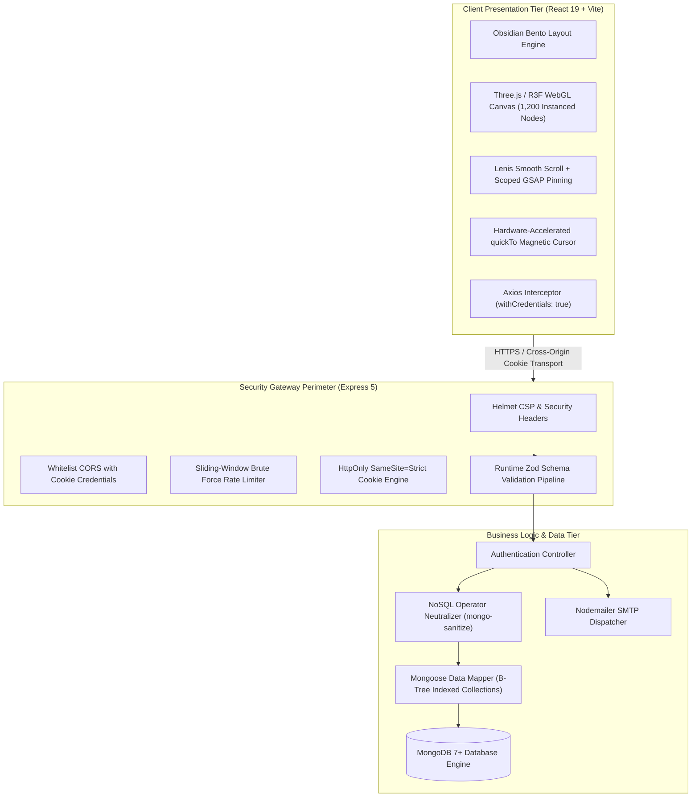
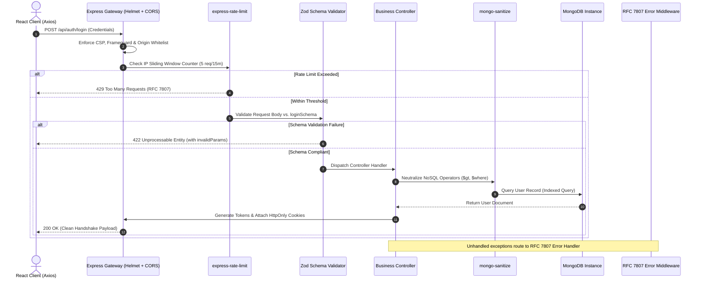

# System Architecture & Defensive Engineering Specification

This document details the architectural topology, perimeter security layers, request dispatch lifecycles, and data model designs for the SaaS Pro cloud orchestration platform.

---

## 1. High-Level Architectural Topology

The platform implements a decoupled, defense-in-depth architecture partitioned across three isolated operational tiers:



---

## 2. Ingress Request Dispatch Lifecycle

Every ingress HTTP request traverses a deterministic validation and security pipeline before invoking business controllers:



---

## 3. Defense-in-Depth Security Perimeter

### A. Token Containment (Zero LocalStorage)
Browser `localStorage` is vulnerable to token extraction via Cross-Site Scripting (XSS). In this platform:
- `accessToken` (15m TTL) is encapsulated in an `HttpOnly`, `Secure`, `SameSite=Strict` cookie (`saas_auth_session`).
- `refreshToken` (7d TTL) is encapsulated in an `HttpOnly`, `Secure`, `SameSite=Strict` cookie (`saas_refresh_session`).
- Client JavaScript cannot read either cookie (`document.cookie` returns empty).
- `SameSite=Strict` guarantees cookies are never dispatched along with cross-origin navigation, neutralizing Cross-Site Request Forgery (CSRF).

### B. Strict Runtime Schema Validation (Zod)
Unlike traditional manual verification or loosely typed middleware, all route ingress endpoints are gated by Zod schemas:
- Strips unexpected fields.
- Sanitizes and lowercases emails.
- Enforces strict password complexity rules (`min(8)`, uppercase character regex, number regex).
- On constraint failure, halts execution before hitting business controllers and returns standardized RFC 7807 Problem Details.

### C. NoSQL Operator Neutralization
Express route handlers process request payloads through `mongo-sanitize`. This removes any keys prefixed with `$` or containing `.`, preventing MongoDB operator injection attacks (such as `{ "password": { "$ne": "wrong" } }`).

### D. Sliding-Window Rate Limiting
Public authentication routes enforce sliding-window rate limiters:
- `POST /api/auth/register`: 5 requests per 15 minutes per IP.
- `POST /api/auth/login`: 5 requests per 15 minutes per IP.
- `POST /api/auth/forgot-password` & `/reset-password`: 3 requests per 1 hour per IP.

---

## 4. Frontend Cinematic Motion & WebGL Architecture

### A. Single RAF Ticker Binding (Lenis + GSAP)
Rather than executing multiple desynchronized `requestAnimationFrame` loops, the Lenis smooth scroll engine binds directly to `gsap.ticker`:

```javascript
// client/src/lib/smooth-scroll.js
gsap.ticker.add((time) => {
  lenisInstance.raf(time * 1000);
});
gsap.ticker.lagSmoothing(0);
```

This guarantees sub-millisecond synchronization between scroll inertia calculations and GSAP ScrollTrigger timeline evaluations, preventing visual tearing and pin jitter.

### B. Single Draw Call InstancedMesh WebGL Canvas
The hero visual layer in [`client/src/components/webgl/HeroWebGLCanvas.jsx`](file:///c:/Users/Admin/OneDrive/Desktop/Source%20Code/MERN%20SaaS%20Boiler-Plate/client/src/components/webgl/HeroWebGLCanvas.jsx) renders a 1,200-node dynamic constellation using Three.js `InstancedMesh`:
- Renders 1,200 nodes in exactly **one GPU draw call**.
- Restricts Device Pixel Ratio (DPR) to `[1, 1.8]` to avoid 4K fill-rate exhaustion.
- Utilizes ACES Filmic tonemapping.
- Calculates lerped normalized device coordinates (NDC) for mouse parallax tracking.

---

## 5. Data Model Design (MongoDB & Mongoose)

The platform user entity is defined in [`server/models/User.js`](file:///c:/Users/Admin/OneDrive/Desktop/Source%20Code/MERN%20SaaS%20Boiler-Plate/server/models/User.js):

| Field | Type | Indexes | Description |
|---|---|---|---|
| `name` | String | None | User display name |
| `email` | String | **Unique B-Tree Index** | Case-insensitive registered email address |
| `password` | String | None | Hashed bcrypt string (12 rounds) |
| `role` | String | None | Enum: `user`, `admin` |
| `verified` | Boolean | None | Email verification status flag |
| `verificationToken` | String | Sparse Index | Cryptographic account verification token |
| `resetPasswordToken` | String | Sparse Index | 1-hour cryptographic password reset token |
| `resetPasswordExpires`| Date | None | Expiration timestamp for reset token |
| `refreshTokens` | Array | Compound Index | Array of `{ token: String, expiresAt: Date, createdAt: Date }` |
